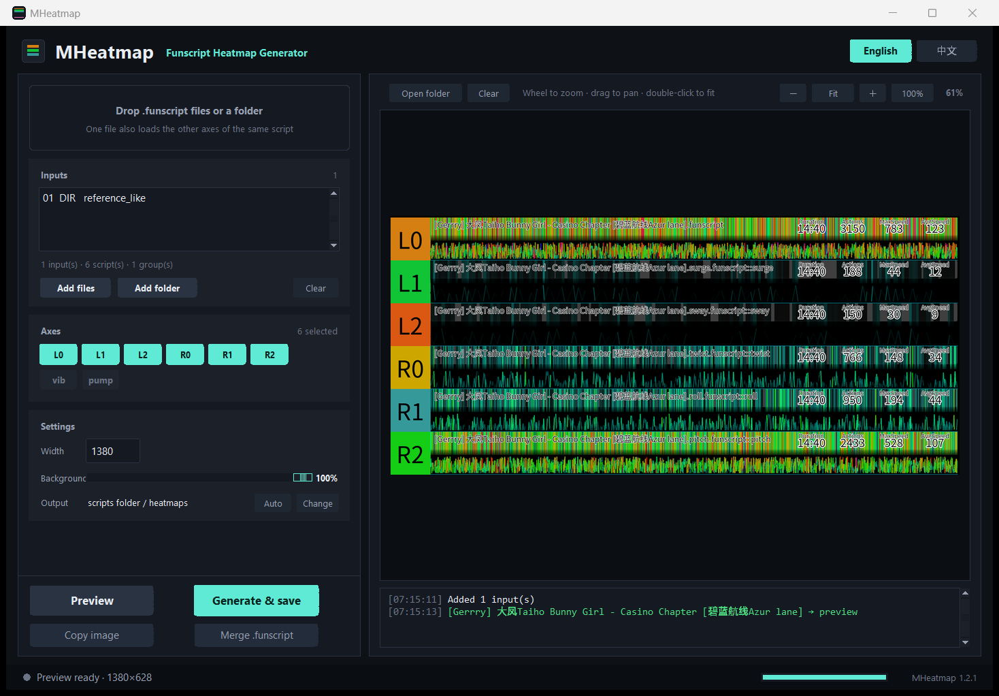
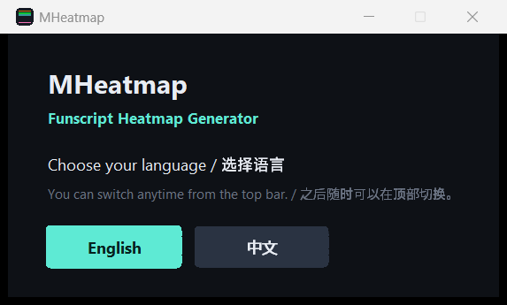
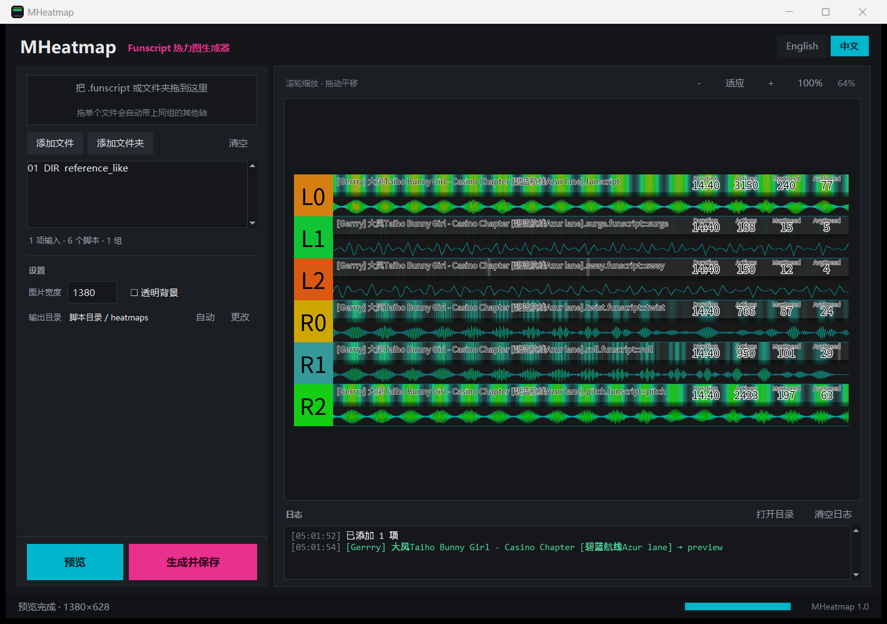

# MHeatmap

[](https://github.com/SillyMeo-1/MHeatmap/actions/workflows/build.yml)
[](LICENSE)

**Funscript Heatmap Generator** — a small desktop app that turns `.funscript`
files into one row-per-axis heatmap (filename banner, speed stats, heat band,
speed curve), with axis selection, an adjustable background opacity and an
optional multi-axis `.funscript` export.

English + 中文 UI. **English by default**; the first launch asks which language
you want, and you can switch anytime from the top bar.



## Install (Windows)

1. Download `MHeatmap.zip` from [Releases](../../releases).
2. Unpack it anywhere and run `MHeatmap.exe` (no installer, no Python).
3. If Windows says “Windows protected your PC”, choose *More info → Run anyway* —
   that is the normal prompt for an unsigned exe.

Or run from source (Python 3.10+):

```powershell
py -3 -m pip install -r requirements.txt
py -3 app.py
```

## Screenshots

| First launch | 中文界面 | Axis pills + opacity |
|---|---|---|
|  |  |  |

## Layout

```
MHeatmap/
├─ app.py                  # Tkinter UI (bilingual, first-run language picker)
├─ mheatmap/
│  ├─ core.py              # funscript parsing + rendering (Pillow only)
│  ├─ i18n.py              # English / 中文 strings
│  └─ __init__.py
├─ assets/
│  ├─ NotoSansCJKsc-Regular.otf   # bundled font (SIL OFL, see OFL.txt)
│  ├─ OFL.txt
│  └─ icon.ico
├─ packaging/README.txt    # readme that goes into the release zip
├─ tools/
│  ├─ build_release.ps1    # build exe + zip
│  ├─ make_sample.py       # six-axis demo scripts for the self test
│  ├─ run_checks.py        # automated checks
│  └─ shot.py              # window screenshots (PrintWindow, DPI-safe)
├─ .github/workflows/build.yml   # CI: test + build exe + release on tag
├─ MHeatmap.spec           # PyInstaller build
├─ requirements.txt
└─ README.md
```

## Features

- **One image per script set**: every axis gets a row (L0/L1/L2/R0/R1/R2 + vib/pump),
  with a translucent filename banner (`name.surge.funscript::surge`),
  Duration / Actions / MaxSpeed / AvgSpeed stats, a heat band and a speed curve.
- **Pick the axes**: toggle the L0…R2 pills; only the chosen axes are drawn and
  the image height follows (fewer axes → shorter image).
- **Copy image** (or `Ctrl+C`): puts the current preview on the clipboard as
  CF_DIB **and** PNG, so Paint, Word, browsers and chat apps all paste it.
- **Merge .funscript** is its own button: it only writes
  `xxx_merged.funscript` (funscript **1.1** — `actions` = stroke axis, `axes` =
  the other channels with `id` + `actions`) without generating any PNG.
- **Background opacity slider**: 0 % = fully transparent PNG, 100 % = solid,
  values in between work too; output names carry `_bg<value>` when it is not 100.
- **One palette** — the OFS rainbow ramp.
- **Interactive UI**: rounded buttons and pills with hover/press states, a card
  layout, mint accent, a status dot that pulses while working, and toast messages
  for copy / save / merge.
- **English + 中文 UI**, English by default, first launch asks for the language.
- **Single-file Windows build**: no installer, no Python.

## Run / build

```powershell
py -3 -m pip install -r requirements.txt
py -3 app.py                      # run from source
py -3 app.py --selftest "D:\path\to\scripts"   # render check without the window

py -3 -m pip install "PyInstaller>=6.11,<7"
powershell -ExecutionPolicy Bypass -File tools\build_release.ps1
# -> dist\MHeatmap.exe + dist\MHeatmap.zip
```

Pushing a `v*` tag triggers the GitHub Actions workflow, which builds the exe on
`windows-latest` and attaches both files to the release.

## File / axis naming

| Axis | Tokens accepted in the filename |
|---|---|
| L0 (stroke) | `.l0`, `.stroke` (also a plain `name.funscript`) |
| L1 (surge)  | `.l1`, `.surge` |
| L2 (sway)   | `.l2`, `.sway` |
| R0 (twist)  | `.r0`, `.twist` |
| R1 (roll)   | `.r1`, `.roll` |
| R2 (pitch)  | `.r2`, `.pitch` |
| vib / pump  | `.vib`, `.pump` |

Scripts in the same folder with the same base name are grouped into one image.
Dropping a single file also picks up its sibling axes.

## Output

- `<group>_Axes.png` — solid background (100 %).
- `<group>_Axes_bg<value>.png` — any other background opacity (0 = transparent).
- `<group>_merged.funscript` — when the “Merge .funscript” button is pressed.

Default width 1380 px, row height 104 px, so six axes give a 1380×628 image
(fewer selected axes → shorter image).

## Checks

```powershell
py -3 tools/run_checks.py
```

Covers parsing/grouping, render geometry, background-alpha behaviour, axis
filtering, the merged funscript structure, curve colours (holding segments must
stay cyan, never black), clipboard formats (CF_DIB + PNG), the bilingual string
table and the real Tk flow (preview → save → copy → merge → switch language).

## Changelog

### 1.2.2 — curve colour fix

- The speed curve was drawing with the *heat* palette, whose zero value is black and
  whose upper half is dark — flat/holding sections came out as black lines. It now
  uses the dedicated cyan ramp: holding = cyan, movement = green/yellow, fast = red/purple.
- Regression check: a script made of holding segments must render cyan curve pixels.

### 1.2.1 — heatmap colours matched to the reference

- Constant opaque heat band (alpha 212) instead of an intensity-scaled one, so slow
  segments stay as saturated as fast ones.
- Linear palette lookup (no smoothstep), pure-black canvas, hard 40 px band edge with
  a 21 % tail, thicker (2 px) curve.
- The preview re-fits once the layout settles, so it never starts out cropped.

### 1.2.0 — interactive UI, clipboard, standalone merge

- New UI: rounded canvas buttons and pills with hover/press feedback, card layout,
  mint accent, pulsing status dot, toast messages, double-click-to-fit preview.
- **Copy image** button / `Ctrl+C` — clipboard gets CF_DIB **and** PNG.
- **Merge .funscript** is its own button (`Ctrl+M`) and no longer requires generating PNGs.
- Palette selector removed; back to the single OFS ramp.

### 1.1.0 — axis picking, opacity, merged export

- Axis pills (L0…R2): draw only the selected axes, image height follows.
- Background opacity slider 0–100 % with `_bg<value>` output suffix.
- Single-file multi-axis export (funscript 1.1 `axes` array) for MultiFunPlayer-style players.
- Five palettes (OFS / Classic / Inferno / Viridis / Grayscale) — removed again in 1.2.0.

### 1.0.0 — first public release

- Row-per-axis heatmap, bilingual UI with first-run language picker, drag & drop,
  transparent PNG, single-file Windows exe.

## Notes

- Rendering was written from scratch for this app (Pillow only); it does not import
  the original heatmapgen project. The colour tables and row layout are kept
  compatible so the output looks the same.
- Bundled font: Noto Sans CJK SC, licensed under the SIL Open Font License —
  see `assets/OFL.txt`.
